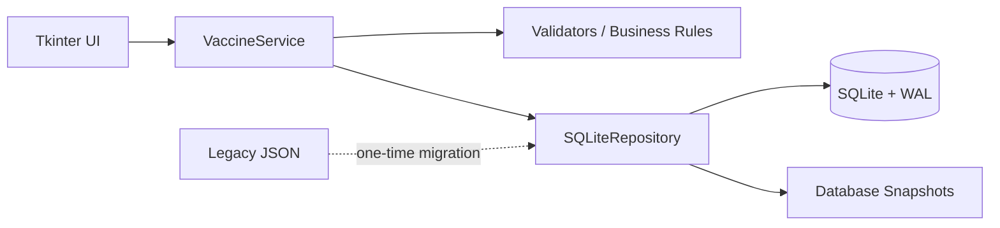

# 疫苗信息管理系统

基于 Python 与 Tkinter 开发的单机桌面业务系统，覆盖疫苗入库、审核、库存、出库、冷链库位、采购、报表和系统管理。项目重点展示桌面应用分层、业务规则落地、SQLite 数据持久化和基础工程化实践。

> 当前版本面向初级桌面软件开发岗位展示。系统定位为单机应用，不包含网络部署和多终端协同能力。

## 功能概览

- 疫苗单个入库、CSV 批量导入和入库审核
- 疫苗档案维护、类别与生产厂家管理
- 库存清单、低库存预警、效期提醒和过期处理
- 按批次出库，支持 FEFO/FIFO 库存校验
- 领用单位、冷链库位、温度与运输信息登记
- 库存看板、ABC 分类、出入库流水与报表
- 采购申请、审批和状态跟踪
- 用户、角色、操作日志、SQLite 备份与恢复
- CSV 数据导出

## 技术栈

| 层次 | 技术 | 用途 |
|---|---|---|
| 桌面界面 | Tkinter / ttk | 登录、表格、表单和多页面导航 |
| 业务层 | Python 3.11+ | 入库、出库、库存、报表等规则 |
| 数据持久化 | SQLite 3，WAL 模式 | 事务写入、故障恢复和单机数据管理 |
| 密码安全 | PBKDF2-HMAC-SHA256 | 随机盐密码哈希，不保存明文密码 |
| 测试 | pytest / unittest 兼容 | 业务逻辑、仓储与安全模块测试 |
| 代码质量 | Ruff | 基础静态检查与未使用导入检测 |
| 持续集成 | GitHub Actions | 每次推送自动运行检查和测试 |
| 桌面打包 | PyInstaller | 生成 Windows 桌面程序 |

项目运行时只依赖 Python 标准库，Tkinter 和 SQLite 不要求额外安装第三方包。

## 架构设计



- `ui/`：页面渲染、表单交互和用户操作入口。
- `services/`：认证、库存、出库、报表等业务逻辑。
- `utils/data_repository.py`：统一持久化接口、事务保存、旧数据迁移和备份。
- `utils/security.py`：密码哈希、验证和初始密码生成。
- `config/`：系统默认参数、角色和样式配置。

### 数据处理

SQLite 通过仓储层进行事务化保存。一次业务操作涉及的多张实体集合会在同一事务中提交，减少“出库记录已写入但库存未扣减”一类数据不一致问题。

当前实体记录使用 JSON payload 存储，以降低从课程项目迁移到数据库的风险；仓储接口已将存储实现与 UI 解耦，后续可以逐步替换为规范化关系表而不改动页面调用方式。

## 快速开始

### 环境要求

- Python 3.11 或更高版本
- Windows 10/11，或其他支持 Tkinter 的桌面系统

确认环境：

```powershell
python --version
python -c "import tkinter, sqlite3; print('desktop runtime ready')"
```

启动程序：

```powershell
python main.py
```

首次运行会自动创建 `data/vaccine_system.db`。如果系统内没有用户，会生成管理员账号 `admin` 和一次性随机密码，并在启动时弹窗显示。

如果需要固定本地开发密码，可以在启动前设置环境变量：

```powershell
$env:VACCINE_ADMIN_PASSWORD="change-this-password"
python main.py
```

密码至少需要 8 个字符。该环境变量仅用于本地首次初始化，不会被写入源码。

### 使用示例数据

系统支持批量入库。可使用 [samples/vaccines.csv](samples/vaccines.csv) 演示导入流程：

1. 登录系统。
2. 进入“基础数据管理 -> 疫苗入库 -> 批量入库”。
3. 选择 `samples/vaccines.csv`。
4. 在“入库审核”中审核记录。

示例文件只包含虚构数据，不包含真实联系人、账号或业务记录。

## 数据迁移与隐私

- 首次启动时，如果 `data/` 下存在旧版 JSON 文件，仓储层会一次性迁移到 SQLite。
- 旧 JSON 仍保留在原位置，便于核对；确认迁移无误后可由使用者自行归档。
- `data/**`、数据库文件、备份、缓存、虚拟环境和 IDE 配置均已加入 `.gitignore`。
- 密码迁移时会自动转换为 PBKDF2 哈希，登录后不会以明文形式再写入数据库。
- 仓库不应提交任何真实用户、领用单位、联系电话、地址或业务数据。

## 开发与测试

安装开发依赖：

```powershell
python -m pip install -r requirements-dev.txt
```

运行测试：

```powershell
python -m pytest
```

运行代码检查：

```powershell
python -m ruff check .
```

测试覆盖密码哈希、数据校验、SQLite 持久化、旧 JSON 迁移、用户持久化和基础业务服务。

## 打包为 Windows 应用

```powershell
python -m pip install -r requirements-dev.txt
pyinstaller --noconfirm --windowed --name VaccineManagement main.py
```

生成文件位于 `dist/VaccineManagement/`。应用程序运行时会在可执行文件同级目录创建或读取 `data/`，因此该目录需要具备写权限。

## 目录结构

```text
.
├── config/                 # 配置、角色和界面主题
├── data/                   # 本地数据库与运行时数据，不提交 Git
├── services/               # 业务规则与业务服务
├── ui/                     # Tkinter 窗口与页面
├── utils/                  # SQLite 仓储与安全工具
├── samples/                # 脱敏演示数据
├── tests/                  # 自动化测试
├── main.py                 # 程序入口
├── pyproject.toml          # 项目、测试和 Ruff 配置
└── requirements-dev.txt    # 开发依赖
```

## 主要工程改进

- JSON 整文件覆盖升级为 SQLite 事务持久化。
- 用户、角色、操作日志和设置全部持久化。
- 密码由明文比较升级为带随机盐的 PBKDF2 哈希。
- 登录界面不再枚举系统用户，也不再预填默认密码。
- 操作日志使用当前登录用户，不再统一硬编码为 `admin`。
- 模拟备份页面替换为真实 SQLite 在线快照，支持恢复和删除。
- 出库记录生成与库存扣减在同一数据库事务中完成。
- 增加 pytest 测试、Ruff 检查和 GitHub Actions 持续集成。
- 增加可复现的开发依赖、Git 忽略规则和项目文档。

完整整改状态与后续优先级见 [整改清单](docs/IMPROVEMENT_CHECKLIST.md)。

## 已知限制

- 当前是单机桌面应用，不提供远程 API、多终端实时协作或云端同步。
- 权限控制目前覆盖页面入口，服务层尚未完整实现细粒度操作审计授权。
- SQLite 采用实体快照存储，尚未拆分为完全规范化的关系表。
- 目前未接入正式发票、监管平台或外部冷链设备接口。
- 大数据量报表仍以本地计算为主，适合中小规模演示数据。

## 后续演进

1. 将实体 payload 拆分为规范化表，并引入数据库迁移脚本。
2. 将服务层权限校验覆盖到所有写操作。
3. 增加库存和出库流程的端到端 UI 测试。
4. 为批量导入增加表头校验、错误行定位和事务回滚。
5. 增加 PDF/Excel 报表导出和打印模板。
